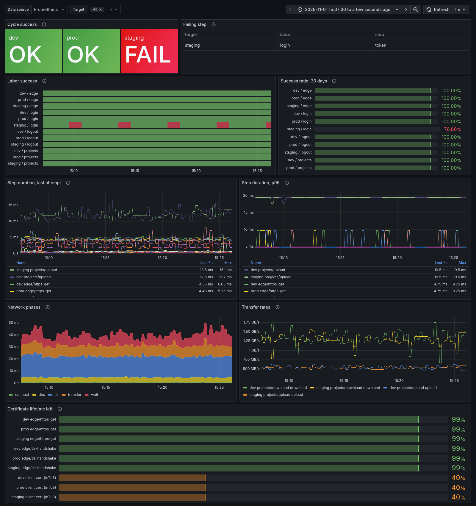

# herakles

[](https://github.com/raulnid/herakles/actions/workflows/ci.yml)

A synthetic probe for multi-step user journeys, built to run inside Kubernetes
and report to Prometheus.

You describe a journey in YAML, the way a real client walks it: log in with an
API key, upload a file, download it and check it is the same, edit it, delete
it, log out. herakles repeats it every interval against each environment and
exposes how every step went as metrics.

```
              every interval, per target, in parallel
  ┌─────────────────────────────────────────────────────────────┐
  │  login ──► projects ─────────────────────► logout           │
  │  api key   upload zip, download + sha256,  (finalizer:      │
  │  → token   rename, delete, check it's gone  always runs)    │
  └─────────────────────────────────────────────────────────────┘
                      │ one result per step
                      ▼
           /metrics ◄── Prometheus ── alerts
```

## Why

A blackbox probe answers "does the endpoint respond?". A journey probe answers
the question your users care about: **can a client log in and do its work right
now?** It catches what a ping cannot: a login that returns 200 with a token
that does not work, storage that accepts an upload and serves back corrupted
bytes, a delete that answers 204 and deletes nothing.

herakles is not a load generator like k6 or Artillery. It runs one journey at
a time per environment and measures it precisely: per-step latency, HTTP
phases (DNS, connect, TLS, time to first byte, transfer), and upload and
download rates. It is designed as a long-running process with native metrics,
not as a CLI tool that prints a report and exits.

### When to use something else

| Tool | Best at | herakles instead, when |
|---|---|---|
| [Prometheus blackbox exporter](https://github.com/prometheus/blackbox_exporter) | One request per probe: HTTP, TCP, DNS, ICMP, gRPC. | The check is a sequence: log in, carry the token, upload, read it back, clean up. |
| [Grafana k6](https://k6.io/) | Load tests scripted in JavaScript; synthetic checks in Grafana Cloud. | You want declarative YAML, a probe that runs inside your cluster as a plain Deployment, and Prometheus metrics without a cloud service. |
| [Checkly](https://www.checklyhq.com/) | Hosted API and browser (Playwright) checks, monitoring as code. | Targets are internal, or the data must not leave your infrastructure. |
| [Artillery](https://www.artillery.io/) | Load tests from YAML scenarios. | You need one precise journey per cycle, not traffic volume. |

These tools can be combined: blackbox for every endpoint, herakles for the
few journeys that matter, k6 or Artillery before a release.

## Quickstart

Requires Go 1.26. From the repository root, start the demo API and run one
cycle of the [example journey](examples/herakles.yaml):

```sh
go run ./examples/eurystheus &
go run ./cmd/herakles run -once -config examples/herakles.yaml
```

```
22:14:34.865 INFO  prod     projects       2/6   upload                 | -- skipped: mutating step on a safe target
22:14:34.865 INFO  prod     projects       3/6   download               | -- skipped: needs "project_id", which was not set
22:14:34.866 INFO  dev      projects       2/6   upload                 | >> Upload a 5 MiB zip of random content  needs: base_url, token
22:14:34.881 INFO  dev      projects       2/6   upload                 | ok 16ms -> project_id, upload  up 471.4 MB/s
22:14:34.881 INFO  dev      projects       3/6   download               | >> The stored file matches the upload byte for byte  needs: base_url, project_id, token, upload
22:14:34.885 INFO  dev      projects       3/6   download               | ok 4ms  down 1.4 GB/s
...
22:14:34.887 INFO  dev      (cycle)                                     | == ok in 25ms
```

The exit code is 0 when every required step passed and 1 otherwise. Without
`-once`, herakles keeps running and serves metrics on `:9090/metrics`.

To deploy it to a local kind or k3d cluster, see
[examples/kubernetes](examples/kubernetes).

## Concepts

| Term | Meaning |
|---|---|
| **target** | An environment to probe (dev, prod...), with its own variables. Targets run in parallel and never wait for each other: a slow or failing target does not delay the others. Every metric carries a `target` label. |
| **labor** | A scenario: an ordered list of steps. Labors run in order. When a required step fails, the labor stops and records which step failed. The remaining labors of the cycle are skipped. |
| **step** | One action, done by a module (`http` or `tcp`). It declares what it does, reads variables set earlier and sets new ones. `optional: true` records a failure without stopping the labor. |
| **finally** | Cleanup steps of a labor that always run, like a `defer`. Example: delete what the labor created, even if a step in between failed. A finally step whose variables were never set is skipped, because there is nothing to clean up. |
| **finalizer** | A labor marked `finalizer: true`. It runs at the end of every cycle, even after a failure. Use it for logout. |
| **cycle** | One run of every labor of a target, every `interval`. Each cycle starts with empty variables: no token or id from a previous cycle is ever reused. File and env variables are read again every cycle, so a rotated secret is picked up on its own. |
| **safe / mutating** | Steps that write are marked `mutating: true`. On a target with `safe: true` they are skipped, and so are the steps that need their outputs. The same YAML probes dev read-write and prod read-only. |

## Documentation

| Guide | What it covers |
|---|---|
| [Configuration](docs/configuration.md) | Settings, variables and secrets, targets and TLS, labors and steps, `foreach`, the `http` and `tcp` modules, payloads, verifying downloads. |
| [Metrics](docs/metrics.md) | Every series, alerts, certificate expiry, SLOs and burn rate, the Grafana dashboard, watching the probe. |
| [Operations](docs/operations.md) | Command line, CI pipelines and JUnit, logs, tracing, running in Kubernetes. |
| [Security](docs/security.md) | What herakles protects and how, verifying release signatures and provenance. |
| [Writing a module](docs/writing-modules.md) | The module contract, with `tcp` as a worked example. |



## Design

```
cmd/herakles          CLI, wiring, /metrics and /health
internal/config       YAML types and structural checks
internal/vars         per-cycle variables, file/env sources, secret redaction
internal/tmpl         template rendering on the YAML tree, variable references
internal/engine       per-target loops, cycles, labors, finally, finalizers, validate
internal/module       the module contract and registry
internal/modules/     http (httpstep), tcp (tcpstep) and payload
internal/metrics      Prometheus observer
internal/logfmt       log observer and fixed-width handler
internal/junit        JUnit report observer for -once
examples/             journey, eurystheus mock API, Kubernetes manifests
schema/               JSON Schema of the config
```

- **The engine emits events, observers report them.** Metrics and logs are two implementations of `engine.Observer`, so neither knows about the other, and tests record events directly.
- **The config tree is rendered, then decoded.** Templates are expanded on the YAML nodes and the result is decoded into the module's own struct. Modules get native Go types and stay template-free.
- **Built for a long-running process.** Templates and JSONPath expressions are parsed once and cached, and per-step metadata is computed when the engine starts. Everything else that could carry state, such as variables, the HTTP client, connections and cookies, is rebuilt every cycle, so no cycle can depend on the previous one.
- **Failures stay contained.** A panicking module fails its step, not the process. Every step is bounded by a timeout. Cleanup and finalizers survive shutdown.

## Known limits

- **No load testing.** Each labor runs once per cycle. Concurrency per labor is planned, with an isolated variable map for each copy.
- **Leftovers last one cycle.** A hard kill between creating and deleting a resource leaves it until the next cycle's [sweep](docs/configuration.md#sweeping-leftovers-with-foreach) deletes it, if you configure one.
- **`foreach` runs items in sequence and stops at the first failure.** There are no other loops, conditions or filters in the YAML; filter in the JSONPath.
- **Payload uploads use chunked encoding.** Servers that require a `Content-Length` on uploads are not supported yet.
- **Probes from inside the cluster.** herakles probes your services from inside the cluster. It does not cover the client's network path: their DNS, proxies or certificates.
- **A failed cycle is not a failed labor run.** When variables or TLS files cannot be loaded, no labor runs, so `labor_runs_total` and the SLO ratio do not see it. `herakles_cycle_success` and the `HeraklesCycleFailing` alert do.
- **Burn-rate alerts on few samples.** A probe runs one request per step per cycle. With `interval: 30s` a 5m window holds about 10 runs, so the short windows react to single failures and the long windows decide.
- **No STARTTLS.** The `tcp` module does TLS from the first byte. Services that upgrade a plain connection (SMTP on 587, PostgreSQL) are checked at the TCP level only.
- **Certificate expiry is what the step saw.** It covers the chain the server sends, not certificates on other endpoints, nodes behind a load balancer or a CDN the step did not reach.
- **Redaction works on text.** A secret shorter than 4 bytes is not masked (a warning is logged). A secret transformed by the server in other ways, such as base64 or partially, cannot be recognized.

## Development

```sh
go vet ./... && go test -race ./...
go run github.com/golangci/golangci-lint/v2/cmd/golangci-lint@v2.15.0 run
go run golang.org/x/vuln/cmd/govulncheck@v1.9.0 ./...
```

CI pins every action to a commit SHA (Dependabot keeps them current) and
builds with the latest patch release of Go.

The tests run every module against fake servers (`httptest`) and include
failure cases:

- a checksum mismatch;
- an endpoint that is down;
- a timeout;
- an optional step that fails;
- cleanup after a failure;
- a finalizer that runs after another labor failed;
- a mutating step skipped on a safe target;
- secrets echoed back by the server.

The example journey also runs end to end against the mock, both as a Go test
and in CI between two containers.

## License

[Apache-2.0](LICENSE)
