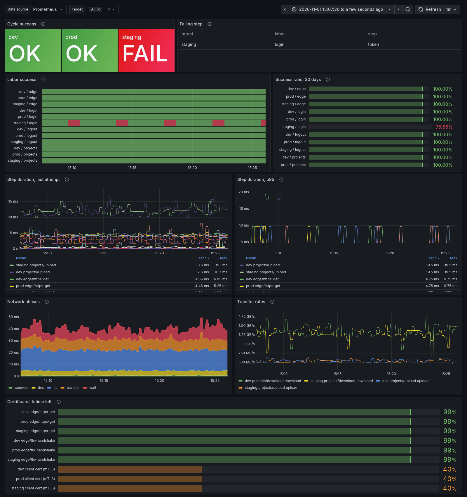

# Metrics

All metrics are prefixed `herakles_` and labeled `target`, plus `labor`,
`step`, `phase` or `direction` where they apply.

| Metric | Type | Labels | Meaning |
|---|---|---|---|
| `step_duration_seconds` | histogram | target, labor, step | Duration of every step attempt. |
| `step_last_duration_seconds` | gauge | target, labor, step | Exact duration of the last attempt. |
| `step_success` | gauge | target, labor, step | 1 if the last attempt passed, 0 if it failed. Includes optional steps. |
| `step_skipped` | gauge | target, labor, step | 1 if the step was skipped in its last cycle. |
| `labor_success` | gauge | target, labor | 1 if the last run of the labor passed. |
| `labor_last_success_timestamp_seconds` | gauge | target, labor | When the labor last passed. Use it to detect a stalled probe. |
| `labor_duration_seconds` | histogram | target, labor | Duration of every labor run, finally included. |
| `labor_last_duration_seconds` | gauge | target, labor | Exact duration of the last run. |
| `labor_failed_step` | gauge | target, labor, step | 1 on the required step that failed the last run, 0 on the others. |
| `step_phase_seconds` | gauge | target, labor, step, phase | Phases of the last network request of the step. `http`: `dns`, `connect`, `tls`, `wait` (request sent to first byte), `transfer`, `total`; on a reused connection `dns`, `connect` and `tls` are 0. `tcp`: `dns`, `connect`, `tls`, `total`. Named `http_phase_seconds` before v0.3.0. |
| `transfer_bytes_per_second` | gauge | target, labor, step, direction | Rate of the last `upload` or `download`. |
| `tls_cert_expiry_timestamp_seconds` | gauge | target, labor, step | Earliest `NotAfter` in the server certificate chain, set by steps that got a TLS response, reused connections included. |
| `tls_cert_not_before_timestamp_seconds` | gauge | target, labor, step | `NotBefore` of that same certificate. With the expiry it gives the lifetime, for alerts relative to it. |
| `tls_client_cert_expiry_timestamp_seconds` | gauge | target | `NotAfter` of the target's mTLS client certificate, as loaded in the last cycle. If it stops loading, the last value stays, so the alert still fires before it expires. |
| `tls_client_cert_not_before_timestamp_seconds` | gauge | target | `NotBefore` of the client certificate. |
| `labor_runs_total` | counter | target, labor, result | Labor runs by `result`: `ok`, `failed` or `skipped`. The SLO metric. |
| `step_runs_total` | counter | target, labor, step, result | Step attempts by `result`. For diagnosis: which step burns the budget. |
| `build_info` | gauge | version, goversion | Always 1. Shows which herakles version runs where: `herakles_build_info{version!="0.2.0"}`. |
| `cycle_success` | gauge | target | 1 if every required step of the last cycle passed. It is 0 when variables cannot be resolved, for example an unreadable secret file. |

A skipped labor does not update its gauges. Its last success timestamp ages,
which is exactly what a staleness alert should catch. It does count as
`result="skipped"`.

## Certificate expiry

A fixed threshold such as "less than 7 days left" fires all the time with
24-hour certificates and too late for some 1-year ones. What matters is
whether renewal happened. cert-manager renews at two thirds of the lifetime by
default, so less than a third left means it did not:

```promql
herakles_tls_cert_expiry_timestamp_seconds - time()
  < (herakles_tls_cert_expiry_timestamp_seconds - herakles_tls_cert_not_before_timestamp_seconds) / 3
```

That is `HeraklesCertNotRenewed` in the example rules: 8 hours left for a
24-hour certificate, 30 days for a 90-day one. If you renew on another
schedule, change the `/ 3`. Every cycle opens new connections, so a renewed
server certificate shows up in the next cycle.

`HeraklesClientCertNotRenewed` applies the same rule to the mTLS client
certificate of each target (`herakles_tls_client_cert_*`). It catches both a
renewal that failed and a renewed Secret that never reached the pod.

## SLOs: counters next to gauges

Gauges hold only the last state: a scrape every 30 seconds cannot tell you how
many cycles failed last month. The run counters can, so they back success
ratios over any window and burn-rate alerts. Every `result` series is created
at 0 the first time a labor or step runs, so `rate()` sees the first failure.

A labor is the user journey (log in, upload, download), so the SLO is on
`labor_runs_total`. Skipped runs are left out: a labor skipped after an
earlier one failed is already counted as that failure.

```promql
# Success ratio over 30 days, per target and labor
sum by (target, labor) (increase(herakles_labor_runs_total{result="ok"}[30d]))
/
sum by (target, labor) (increase(herakles_labor_runs_total{result=~"ok|failed"}[30d]))
```

For a 99.9% objective the error budget is 0.1%. The multiwindow burn-rate
alert from the Google SRE workbook pages when the budget burns 14.4 times too
fast over 1h (2% of the monthly budget) or 6 times too fast over 6h (5%). Each
long window is paired with a short one (5m, 30m), so the alert stops soon
after the problem does:

```promql
(
  herakles:labor_error_ratio:rate1h > (14.4 * 0.001) and herakles:labor_error_ratio:rate5m > (14.4 * 0.001)
) or (
  herakles:labor_error_ratio:rate6h > (6 * 0.001) and herakles:labor_error_ratio:rate30m > (6 * 0.001)
)
```

where each `herakles:labor_error_ratio:rateW` is a recording rule:

```promql
sum by (target, labor) (rate(herakles_labor_runs_total{result="failed"}[W]))
/
sum by (target, labor) (rate(herakles_labor_runs_total{result=~"ok|failed"}[W]))
```

The recording rules and the `HeraklesLaborErrorBudgetBurn` alert are in the
example PrometheusRule. A probe runs far fewer requests than real traffic:
with `interval: 30s`, the 5m window holds about 10 runs, so one failure is a
10% error ratio and passes the short threshold on its own. The long window is
what keeps a single failure from paging. When the burn alert fires,
`step_runs_total` shows which step fails:

```promql
topk(3, sum by (labor, step) (increase(herakles_step_runs_total{target="prod",result="failed"}[1h])))
```

## Why exact gauges next to histograms

Probe requests often take a few milliseconds. With histogram buckets, every
quantile inside the same bucket is interpolated, so steps of 3 ms and 9 ms can
both show a p95 of 10 ms. Use histograms for rate-style alerts. For real
latency, use the exact last-value gauges, and for percentiles over time:

```promql
quantile_over_time(0.95, herakles_step_last_duration_seconds{target="prod"}[1h])
quantile_over_time(0.95, herakles_step_phase_seconds{phase="wait"}[1h])
```

Example alerts (failing labor, stale labor, failing cycle, slow step, slow
transfer, certificate not renewed, error budget burn) are in
[`examples/kubernetes/monitoring/prometheusrule.yaml`](../examples/kubernetes/monitoring/prometheusrule.yaml).
A Grafana dashboard for these series is in
[`examples/kubernetes/monitoring/dashboard.json`](../examples/kubernetes/monitoring/dashboard.json):



## Health

`/health` answers 200 while the process is alive. It does not depend on probe
results on purpose: an unhealthy target must raise an alert, not make
Kubernetes restart the probe.

## Watching the probe

herakles runs as a single replica, so the probe itself is a single point of
failure, and a dead probe is silent: its series go stale and no rule on them
fires, `HeraklesLaborStale` included. Watch it from one level up each time:

| If this stops | This alerts | How |
|---|---|---|
| herakles (crash loop, pod not scheduled, scrape broken) | Prometheus | `HeraklesDown`: `absent(up{job="herakles"} == 1)` for 5 minutes, in the example rules. |
| Prometheus or Alertmanager | Something outside the cluster | A dead man's switch: an alert that always fires, such as `Watchdog` in kube-prometheus, routed to an external service that pages when it stops arriving. |

Kubernetes restarts a crashed process on its own; `HeraklesDown` covers what a
restart does not fix.
